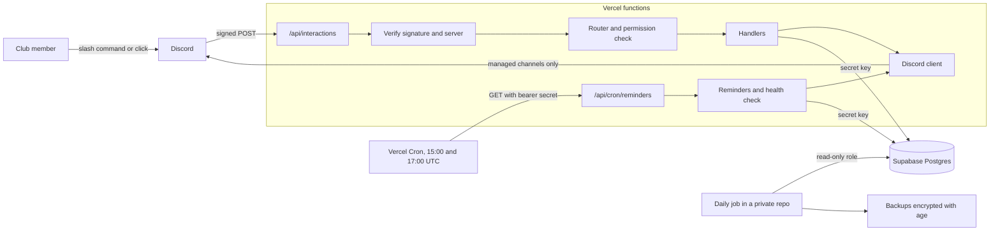

# SASE at GT Events Bot

A Discord bot for the SASE at Georgia Tech events team. It stores events, tasks and deadlines, creates a forum post for each event, and reminds each person about their own tasks.

It runs on free tiers: TypeScript functions on Vercel Hobby and Postgres on Supabase. It has no always-on server and no website.

**Status: v2, in testing.** The bot runs on a private test server, where `/setup`, event steps, the Done buttons and the role pings have been tried. The daily reminders have not run there yet. [docs/STAGING_CHECKLIST.md](docs/STAGING_CHECKLIST.md) lists everything still to check before it joins the club server.

## What it does

An officer creates an event, and the bot opens a post for it in a forum. The officer assigns tasks, and the bot pings each person in that post:

```text
/task assign person:@Sam description:Book the room due:11/20

@Sam, you have a new task:
Book the room
Due 2026-11-20. Task 1a2b3c4d, given by @Alex.
[✅ Mark done]
```

The bot then reminds the person 3 days before, 1 day before, on the due day and once when overdue. After a missed run, only the most urgent reminder goes out. Each reminder has a Mark done button too, labelled with the start of the task.

Each event's workflow steps get reminders in the event's post from the same daily run:

- **Step list**, once a day up to and including the event's day, while any step is open. Budget Sheet and Engage post ping the people on them, or the Events Directors role if nobody is. Budget approved is listed without a ping. Once the budget is approved, Food pickup that has no time or nobody on it pings the event's creator. Nothing is sent when every step is done.
- **Food pickup**, two days before the event and on the day, pinging everyone on Food pickup with the time, such as `5:30 PM`. These need Food pickup set up, which needs the budget approved first.

None of these go out late: a day's message is sent on that day or not at all.

Members see their own open tasks with `/mytasks`, privately:

```text
Your open tasks, soonest first
- 1a2b3c4d, due 2026-11-20, Spring Social: Book the room
```

Each event also follows the club's own steps, shown as a checklist in its overview: Budget Sheet, Engage post, Budget approved and Food pickup. Officers put people on steps with `/event assign`, or with the `budget` and `engage` options of `/event create`. The checklist shows who is on each step, without pinging them, and has a button for each step still open:

```text
Checklist
✅ Budget Sheet: @Sam
⬜ Engage post: @Lee
⬜ Budget approved
⬜ Food pickup: time not set, nobody assigned
[Engage post done] [Budget approved]
```

When Budget Sheet is marked done, the bot pings the Treasury Committee role once in the post. When the Engage post is marked done, it pings the Marketing Committee role. An officer or the Treasury Committee marks the budget approved, and the bot then asks the event's creator to set up food pickup: a time with `/event pickup`, and people with `/event assign step:Food pickup`. `/mytasks` lists your open steps and food pickups too.

The names, dates and ID above are made up.

Admins configure the bot inside Discord: which forums it may post in, and whether reminders are on. Channels and roles are chosen after launch, and none are written into the code.

## Architecture



The bot receives Discord's HTTP interactions and opens no gateway connection. It sees only what it is sent, so it cannot react to messages, role changes or members leaving. [Record 2](docs/adr/0002-http-interactions-on-serverless.md) explains this choice.

Discord allows 3 seconds for the first reply. So the bot makes one database read, sends a private acknowledgement, and finishes the work with `waitUntil`.

| Path                   | Holds                                                      |
| ---------------------- | ---------------------------------------------------------- |
| `api/`                 | The two public endpoints. Every file here becomes a route. |
| `src/discord/`         | Signature checks, safe text, message builders, REST client |
| `src/handlers/`        | The router and each command                                |
| `src/tasks/`           | The `/task` subcommands                                    |
| `src/events/`          | Event input checks, the overview and the event's steps     |
| `src/reminders/`       | The daily run, its plan and the health check               |
| `src/db/`              | All database access                                        |
| `src/lib/`             | Settings, permissions and dates                            |
| `supabase/migrations/` | The schema, grants and database functions                  |
| `backup/`              | Backup scripts and a workflow template for a separate repo |
| `docs/adr/`            | Records of the design decisions and their costs            |

## Commands

Tiers come from the signed request each time, and nothing is cached. Every command except `/ping` and `/setup` refuses until `/setup` has been run. Replies are private unless noted.

| Command         | Who can use it                | What it does                                              |
| --------------- | ----------------------------- | --------------------------------------------------------- |
| `/ping`         | Any member                    | Checks the bot answers. Needs no setup or database.       |
| `/mytasks`      | Any member                    | Lists your own open tasks, steps and food pickups.        |
| `/task done`    | The assignee, or an officer   | Marks a task done. The Mark done button does the same.    |
| `/task assign`  | Officer                       | Creates a task and pings the person in the post.          |
| `/task edit`    | Officer                       | Changes the description, due date or person.              |
| `/task delete`  | Officer                       | Soft-deletes a task, after a Confirm click.               |
| `/event create` | Officer                       | Creates an event and its forum post.                      |
| `/event link`   | Officer                       | Makes the post you are in the home of an event.           |
| `/event status` | Officer                       | Shows an event and its tasks.                             |
| `/event list`   | Officer                       | Lists events in every managed forum.                      |
| `/event close`  | Officer                       | Closes an event and stops its reminders.                  |
| `/event delete` | Officer                       | Soft-deletes an event and its tasks, after a Confirm.     |
| `/config`       | Admin                         | Forums, reminders, the five roles and the last 5 changes. |
| `/setup`        | Administrator permission only | Chooses the five club roles, after a Confirm click.       |

`/setup` chooses five roles: E-board, Events Directors, Events Committee, Treasury Committee and Marketing Committee. The club has no separate admin role: E-board is the admin, so `/setup` saves the E-board role as the admin role too, and `/config` shows it as `E-board (also admin)`. An officer holds the Events Directors or E-board role, or is an admin. An admin holds the E-board role or Discord's Administrator permission. The E-board role does not reach `/setup`. A server whose saved admin role differs from E-board keeps it until `/setup` is run again, and `/config` shows it on its own line. Treasury Committee is pinged when a Budget Sheet is done and can approve budgets. Marketing Committee is pinged when an Engage post is up. Events Committee is shown in `/config` and decides nothing yet. A server set up before these roles existed keeps working, and `/config` says to run `/setup` for each role still missing.

The event's steps have their own commands and buttons:

| Command or button                           | Who can use it                         | What it does                                                 |
| ------------------------------------------- | -------------------------------------- | ------------------------------------------------------------ |
| `/event create` `budget:` `engage:`         | Officer                                | Puts one person each on Budget Sheet and Engage post.        |
| `/event assign`                             | Officer                                | Puts someone on Budget Sheet, Engage post or Food pickup.    |
| `/event unassign`                           | Officer                                | Takes someone off one of an event's steps.                   |
| `/event pickup`                             | Officer                                | Sets the food pickup time, once the budget is approved.      |
| **Budget Sheet done**, **Engage post done** | The people on that step, or an officer | Ticks the step and pings Treasury or Marketing once.         |
| **Budget approved**                         | Officer or Treasury Committee          | Ticks the step and asks the event's creator for food pickup. |

The buttons are on the event's overview. Anyone else who clicks one gets the refusal privately, and the post stays as it is. Food pickup is done once it has a time and at least one person.

[Record 4](docs/adr/0004-role-based-permissions.md) has the reasoning.

## Security model

No system is unhackable, and this one makes no such claim. The aim is to keep the likely failures small and recoverable. [SECURITY.md](SECURITY.md) covers reporting a problem and what to do if a secret leaks.

**Incoming requests**

- Ed25519 signature checked on the raw bytes before parsing. Timestamps over 5 minutes old are refused.
- The request must be for this application, from a member of a server in `ALLOWED_GUILD_IDS`, in a guild install. Anything else is refused.
- The body is limited to 64 KB, and is refused early if declared larger.
- The cron endpoint needs a bearer secret of at least 32 characters. If it is unset or too short, every request is refused. Headers and user agents grant nothing.

**Authorization**

- Deny by default. `COMMAND_POLICY` maps each action to a tier, and a route with an unmapped action stops the app from loading.
- Routes are found in a `Map` by exact match. The same fixed refusal covers an unknown route, the wrong tier and a missing row.
- Rows are loaded by ID and the signed server, and checked. A `custom_id` or autocomplete value can name a row but grants nothing.
- A state-changing route claims the interaction once, so a replayed request changes nothing.

**Database**

- Only the server-side `sb_secret_` key is used, with no browser client.
- Row level security is on with no policies for the API. Row level security does not limit that key, so grants do. The bot's role has no `DELETE` or `TRUNCATE` on its tables, can update `events` and `tasks` only in listed columns, and can only read config tables. Config changes go through functions that check a version and write an audit row. `interaction_claims` is reached only through functions, and its expired rows are removed by one.
- Triggers copy old rows into `history.row_versions`, in a schema the API cannot reach.
- Deletes are soft. CI checks the grants, on a stand-in for hosted Supabase.

**Outgoing messages**

- User text reaches a message only after it is escaped, and every message is built by the same builder functions. Member names and nicknames are never rendered. Masked links and server invites are refused in task text, and plain URLs are escaped so that nothing can click them.
- Every message sets `allowed_mentions` to the named users only, and suppresses link previews.
- Posts go through one client, which checks the channel or its parent is a managed forum in that server. For an event's post the parent is the forum stored on the event's row, so that check needs no request to Discord. CI fails on a direct Discord call anywhere else.
- The bot is invited with `permissions=0` and given View Channel, Send Messages and Send Messages in Threads, per forum. It also gets whatever the server gives `@everyone`, so keep that role narrow.

**Secrets and supply chain**

- Nothing logs a request body or interaction token. Logs hold fixed text, IDs and error codes.
- Gitleaks runs in a pre-push hook and in CI, with tested rules. The lockfile is committed and checked by lockfile-lint, install scripts are off, Actions are pinned by SHA, and Dependabot has a 7-day cooldown with no auto-merge.

**Backups**

- A separate private repository runs `pg_dump` through `age` to two key holders, with a read-only role. It fails if row counts disagree or fall sharply, and if the reminder job has gone stale. See [docs/BACKUPS.md](docs/BACKUPS.md).

## Risks that remain

These stay true with every control working:

- **Discord admins.** A Discord Administrator can give themselves every tier. Anyone who can manage roles can grant a bound role below their own, and the bot is not told when that happens.
- **Stolen secrets.** A leaked bot token or Supabase secret key bypasses this code. Rotating stops further use, but what was done with it stays done: role bindings, managed forums and skipped reminders are not undone, and row history does not cover them. Data read before then stays exposed. [SECURITY.md](SECURITY.md#2-check-for-misuse) lists the checks to make after a leak. Row history and backups recover events and tasks, which the secret key can still overwrite.
- **Account takeover.** A takeover of the maintainer's GitHub, Vercel, Supabase or Discord account defeats all of this. So does a platform incident. Supabase's login offers only authenticator codes, not a passkey or hardware key.
- **A trusted officer.** An officer, or a stolen officer account, can still ping people with persuasive plain text and a URL. It cannot be clicked, but it can be copied. Only a person can judge such text.
- **What officers can read.** An officer can see events through the bot in forums they cannot open in Discord.
- **Who did it.** Officer edits, completions and deletes record no actor, so after a stolen officer account they may not be traceable to it. [SECURITY.md](SECURITY.md#what-can-be-attributed) says what can be.
- **Autocomplete replay.** Discord takes autocomplete choices only in the HTTP response, so they cannot be deferred. Someone holding a captured signed request can replay it for 5 minutes and read current task or event text. Getting one needs a compromised host or proxy.
- **Floods.** A flood of requests can use up Vercel Hobby's limits and take the bot offline, in most cases for 30 days. It costs availability, not money. Hobby's firewall rules reduce this, and do not stop it.
- **Missed runs.** Vercel Cron is best effort with no retries. A second cron and the freshness check in the backup job reduce this, but a reminder can be late or, after a crash, sent twice. An event's step list or Food pickup reminder is never late: if both crons of its day miss, it is not sent.
- **Held reminders.** If the bot loses Send Messages across a server while it can still read the forums, each event's reminders are held after three refused runs, and the job goes green with nothing sent. No alert fires. [The runbook](docs/RUNBOOK.md#reminders-held-while-the-job-is-green) says how to spot it.
- **Dependencies.** A compromised dependency would run with full access to the secrets. Pinning and cooldowns lower the odds only.
- **Backups.** A former key holder can still read old backups, and a former member's text stays in them until the old repository is deleted.
- **Short logs.** Hobby keeps logs for one hour, which limits what can be learned after an incident.
- **Unproved.** Grants have only been tested on stand-ins, and backups on plain Postgres in CI, not on hosted Supabase. See [docs/STAGING_CHECKLIST.md](docs/STAGING_CHECKLIST.md).

## Local development

You need Node.js 24, Git, Bash and curl 7.71 or later, on macOS or Linux.

```sh
npm ci --ignore-scripts
npm run gitleaks:install
npm run hooks:install
```

The committed `.npmrc` sets `ignore-scripts=true`, so package install scripts stay off in every install, including Vercel's. `hooks:install` turns on a pre-push hook that blocks a detected secret, a denied file type or an email that is not a noreply address. [SECURITY.md](SECURITY.md) lists its limits.

There is no local bot. Discord needs a public HTTPS URL, so tests stand in for it, and real runs happen on the test deployment. `.env.example` lists every setting. Copy it to `.env` only when you need to register commands.

### Tests and checks

| Command                                                           | What it does                                                                                          | Needs                                                                                                                                                        |
| ----------------------------------------------------------------- | ----------------------------------------------------------------------------------------------------- | ------------------------------------------------------------------------------------------------------------------------------------------------------------ |
| `npm run typecheck`                                               | Type check                                                                                            | Nothing                                                                                                                                                      |
| `npm run lint`                                                    | ESLint (only the clients may call `fetch`), and a check that names no Discord host                    | Nothing                                                                                                                                                      |
| `npm run lint:lockfile`                                           | lockfile-lint: every package from the npm registry over HTTPS, by its own name, with a sha512 hash    | Nothing                                                                                                                                                      |
| `npm run format:check`                                            | Prettier                                                                                              | Nothing                                                                                                                                                      |
| `npm test`                                                        | Unit tests                                                                                            | Nothing                                                                                                                                                      |
| `npm run test:db`                                                 | Migrations, grants and access layer on PGlite                                                         | Nothing                                                                                                                                                      |
| `npm run test:db:concurrency`                                     | Races: double Done clicks, retried interactions, overlapping reminder runs, deletes against inserts   | `CONCURRENCY_DATABASE_URL`, a Postgres 17 superuser                                                                                                          |
| `npm run test:postgrest`                                          | Access layer on real PostgREST                                                                        | `POSTGREST_URL` and related settings                                                                                                                         |
| `bash scripts/test-backup-restore.sh`                             | Backup and restore end to end. For disposable servers only: it changes their settings, roles and data | Postgres 17 containers on ports 5432 to 5434 as in `db.yml`, Docker, `psql`, `pg_dump`, `age`, `BACKUP_RLS_PATH`, `POSTGRES_CONTAINER`, `RECOVERY_CONTAINER` |
| `npm run test:secret-rules`                                       | Proves each gitleaks rule fires                                                                       | gitleaks                                                                                                                                                     |
| `npm run test:hooks`                                              | Tests the pre-push hook                                                                               | gitleaks                                                                                                                                                     |
| `npm run test:history-scan`                                       | Tests the history scan                                                                                | gitleaks                                                                                                                                                     |
| `bash scripts/gitleaks-full-history.sh`                           | Scans every commit on every ref                                                                       | gitleaks, a full clone                                                                                                                                       |
| `node scripts/check-commit-messages.ts --range origin/main..HEAD` | Checks a branch's commit messages. `--title="<title>"` checks a pull request title                    | Nothing                                                                                                                                                      |

[CI](.github/workflows/ci.yml) runs the main checks on each pull request and on pushes to `main` and `staging`. [Database](.github/workflows/db.yml) and [Deploy check](.github/workflows/deploy-check.yml) run on the same events but skip a change to `docs/`, `README.md` or `SECURITY.md` alone. The `commit-messages` job in [PR metadata](.github/workflows/pr-metadata.yml) runs on pull requests only, so a direct push to `main` skips it. That job checks each branch commit and the pull request title. `Co-authored-by` trailers on a branch are refused.

### Registering commands

Commands are registered per server, never globally. Set `DISCORD_APP_ID`, `DISCORD_BOT_TOKEN` and `ALLOWED_GUILD_IDS` in `.env`, then run:

```sh
npm run commands:register -- <guild-id>
```

The script stops before sending anything if an ID is not in `ALLOWED_GUILD_IDS`. It replaces the server's whole command list with the one built from `src/handlers/modules.ts`, so run it again after changing a command.

To add a command, write a file in `src/handlers/` that exports `handler`, add one line to `modules.ts`, and map its actions in `src/lib/permissions.ts`. The router refuses to load if a route has no mapped action.

## Deployment

[docs/SETUP.md](docs/SETUP.md) has the full steps. These settings in the repo are easy to break:

- `engines` in `package.json` selects the Node.js version.
- Keep `outputDirectory` set to `public`, and keep `public/robots.txt`, because Vercel refuses an empty output directory. Without a `public` directory, Vercel publishes the repository's files. The [deploy check](.github/workflows/deploy-check.yml) fails if anything but `robots.txt` is published, or if an unexpected function is built.
- Do not add tests or helpers under `api/`.
- `git.deploymentEnabled` deploys `main` and `staging` and nothing else. The rule is `**`, because `*` does not match a branch name containing a slash.
- `vercel.json` applies to every Vercel project linked to the repo. The production project also builds `staging` as a preview, which holds no secrets.
- Vercel's function builder ignores `installCommand`, so `.npmrc` is what keeps install scripts off.
- `.vercelignore` keeps local `.env` files out of a deployment made with the Vercel CLI.
- The two cron schedules must stay in step with `begin_job_run` and `SLOT_START_HOUR_UTC`. The second cron only recovers a failed first run.

## Documentation

- [docs/SETUP.md](docs/SETUP.md): from nothing to a test server, then production
- [docs/STAGING_CHECKLIST.md](docs/STAGING_CHECKLIST.md): what only real services can prove
- [docs/BACKUPS.md](docs/BACKUPS.md): backups, restore drills and recovery
- [docs/RUNBOOK.md](docs/RUNBOOK.md): held reminders, the bot removed from a server, a full database, deploy order and data retention
- [docs/HANDOFF.md](docs/HANDOFF.md): passing the bot to the next maintainer
- [docs/PUBLIC_RELEASE.md](docs/PUBLIC_RELEASE.md): going public
- [docs/adr/](docs/adr/): decision records
- [SECURITY.md](SECURITY.md): reporting a problem and handling a leak
