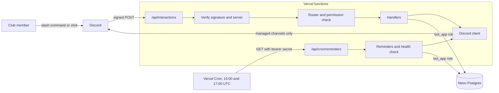

# SASE at GT Events Bot

A Discord bot for the SASE at Georgia Tech events team. It stores events, tasks and deadlines, creates a forum post for each event, and reminds each person about their own tasks.

It runs on free tiers: TypeScript functions on Vercel Hobby and Postgres 17 on Neon. It has no always-on server and no website.

**Status: v2, in testing.** The bot runs on a private test server, where `/setup`, event steps, the Done buttons and the role pings have been tried. The daily reminders have not run there yet, and the Neon setup has not yet been tried live. [docs/STAGING_CHECKLIST.md](docs/STAGING_CHECKLIST.md) lists everything still to check before it joins the club server.

## What it does

An officer creates an event, and the bot opens a post for it in a forum. The officer assigns tasks, and the bot pings each person in that post:

```text
/task assign person:@Sam description:Book the room due:11/20

@Sam, you have a new task:
Book the room
Due 2026-11-20. Task 1a2b3c4d, given by @Alex.
[✅ Mark done]
```

The bot then reminds the person 3 days before, 1 day before, on the due day and once when overdue. After a missed run, only the most urgent reminder goes out. Each reminder has a Mark done button too, labelled with the start of the task.

Each event's workflow steps get reminders in the event's post from the same daily run:

- **Step list**, once a day up to and including the event's day, while any step is open. Budget Sheet and Engage post ping the people on them, or the Events Directors role if nobody is. Budget approved is listed without a ping. Food pickup is never on this list. Nothing is sent once Budget Sheet, Engage post and Budget approved are all done.
- **Food pickup**, two days before the event and on the day, pinging everyone on Food pickup with the time, such as `5:30 PM`. These need Food pickup set up, which can be done at any time, before or after the budget is approved.

None of these go out late: a day's message is sent on that day or not at all.

Members see their own open tasks with `/mytasks`, privately:

```text
Your open tasks, soonest first
- 1a2b3c4d, due 2026-11-20, Spring Social: Book the room
```

Each event also follows the club's own steps, shown as a checklist in its overview: Budget Sheet, Engage post, Budget approved and Food pickup. Officers put people on steps with `/event assign`, or with the `budget` and `engage` options of `/event create`. The checklist shows who is on each step, without pinging them, and has a button for each step still open:

```text
Checklist
✅ Budget Sheet: @Sam
⬜ Engage post: @Lee
⬜ Budget approved
⬜ Food pickup: time not set, nobody assigned
[Engage post done] [Budget approved]
```

When Budget Sheet is marked done, the bot pings the Treasury Committee role once in the post. When the Engage post is marked done, it pings the Marketing Committee role. An officer or the Treasury Committee marks the budget approved, and the bot notes in the post that the budget is approved, without pinging anyone. Food pickup can be set up at any time: a time with `/event pickup`, and people with `/event assign step:Food pickup`. `/mytasks` lists your open steps and food pickups too, upcoming events soonest first, then any step still open on an event that has passed.

The names, dates and ID above are made up.

Admins configure the bot inside Discord: which forums it may post in, and whether reminders are on. Channels and roles are chosen after launch, and none are written into the code.

## Architecture



The bot receives Discord's HTTP interactions and opens no gateway connection. It sees only what it is sent, so it cannot react to messages, role changes or members leaving. [Record 2](docs/adr/0002-http-interactions-on-serverless.md) explains this choice.

Discord allows 3 seconds for the first reply. So the bot makes one database read, sends a private acknowledgement, and finishes the work with `waitUntil`.

| Path             | Holds                                                      |
| ---------------- | ---------------------------------------------------------- |
| `api/`           | The two public endpoints. Every file here becomes a route. |
| `src/discord/`   | Signature checks, safe text, message builders, REST client |
| `src/handlers/`  | The router and each command                                |
| `src/tasks/`     | The `/task` subcommands                                    |
| `src/events/`    | Event input checks, the overview and the event's steps     |
| `src/reminders/` | The daily run, its plan and the health check               |
| `src/db/`        | All database access                                        |
| `src/lib/`       | Settings, permissions and dates                            |
| `db/migrations/` | The schema, grants and database functions                  |
| `scripts/`       | Migrations, command registration and the repo's checks     |
| `docs/adr/`      | Records of the design decisions and their costs            |

## Commands

Tiers come from the signed request each time, and nothing is cached. Every command except `/ping` and `/setup` refuses until `/setup` has been run. Replies are private unless noted.

| Command         | Who can use it                | What it does                                              |
| --------------- | ----------------------------- | --------------------------------------------------------- |
| `/ping`         | Any member                    | Checks the bot answers. Needs no setup or database.       |
| `/mytasks`      | Any member                    | Lists your own open tasks, steps and food pickups.        |
| `/task done`    | The assignee, or an officer   | Marks a task done. The Mark done button does the same.    |
| `/task assign`  | Officer                       | Creates a task and pings the person in the post.          |
| `/task edit`    | Officer                       | Changes the description, due date or person.              |
| `/task delete`  | Officer                       | Soft-deletes a task, after a Confirm click.               |
| `/event create` | Officer                       | Creates an event and its forum post.                      |
| `/event link`   | Officer                       | Makes the post you are in the home of an event.           |
| `/event status` | Officer                       | Shows an event and its tasks.                             |
| `/event list`   | Officer                       | Lists events in every managed forum.                      |
| `/event close`  | Officer                       | Closes an event and stops its reminders.                  |
| `/event delete` | Officer                       | Soft-deletes an event and its tasks, after a Confirm.     |
| `/config`       | Admin                         | Forums, reminders, the five roles and the last 5 changes. |
| `/setup`        | Administrator permission only | Chooses the five club roles, after a Confirm click.       |

`/setup` chooses five roles: E-board, Events Directors, Events Committee, Treasury Committee and Marketing Committee. The club has no separate admin role: E-board is the admin, so `/setup` saves the E-board role as the admin role too, and `/config` shows it as `E-board (also admin)`. An officer holds the Events Directors or E-board role, or is an admin. An admin holds the E-board role or Discord's Administrator permission. The E-board role does not reach `/setup`. A server whose saved admin role differs from E-board keeps it until `/setup` is run again, and `/config` shows it on its own line. Treasury Committee is pinged when a Budget Sheet is done and can approve budgets. Marketing Committee is pinged when an Engage post is up. Events Committee is shown in `/config` and decides nothing yet. A server set up before these roles existed keeps working, and `/config` says to run `/setup` for each role still missing.

The event's steps have their own commands and buttons:

| Command or button                           | Who can use it                         | What it does                                              |
| ------------------------------------------- | -------------------------------------- | --------------------------------------------------------- |
| `/event create` `budget:` `engage:`         | Officer                                | Puts one person each on Budget Sheet and Engage post.     |
| `/event assign`                             | Officer                                | Puts someone on Budget Sheet, Engage post or Food pickup. |
| `/event unassign`                           | Officer                                | Takes someone off one of an event's steps.                |
| `/event pickup`                             | Officer                                | Sets the food pickup time.                                |
| **Budget Sheet done**, **Engage post done** | The people on that step, or an officer | Ticks the step and pings Treasury or Marketing once.      |
| **Budget approved**                         | Officer or Treasury Committee          | Ticks the step and notes it in the post, pinging nobody.  |

The buttons are on the event's overview. Anyone else who clicks one gets the refusal privately, and the post stays as it is. Food pickup is done once it has a time and at least one person.

[Record 4](docs/adr/0004-role-based-permissions.md) has the reasoning.

## Security model

No system is unhackable, and this one makes no such claim. The aim is to keep the likely failures small and recoverable. [SECURITY.md](SECURITY.md) covers reporting a problem and what to do if a secret leaks.

**Incoming requests**

- Ed25519 signature checked on the raw bytes before parsing. Timestamps over 5 minutes old are refused.
- The request must be for this application, from a member of a server in `ALLOWED_GUILD_IDS`, in a guild install. Anything else is refused.
- The body is limited to 64 KB, and is refused early if declared larger.
- The cron endpoint needs a bearer secret of at least 32 characters. If it is unset or too short, every request is refused. Headers and user agents grant nothing.

**Authorization**

- Deny by default. `COMMAND_POLICY` maps each action to a tier, and a route with an unmapped action stops the app from loading.
- Routes are found in a `Map` by exact match. The same fixed refusal covers an unknown route, the wrong tier and a missing row.
- Rows are loaded by ID and the signed server, and checked. A `custom_id` or autocomplete value can name a row but grants nothing.
- A state-changing route claims the interaction once, so a replayed request changes nothing.

**Database**

- The bot logs in as `bot_app`, a role that owns nothing, belongs to no role, cannot create anything or make temporary tables, and does not bypass row level security. Any other role in `DATABASE_URL` is refused at startup, and a non-local host needs TLS.
- `bot_app` has no `DELETE` or `TRUNCATE` anywhere. It can read the app's tables, insert named columns of `events` and `tasks`, and update only listed columns of them. A task's text, date or person changes only through `edit_task`, which counts a new person against the officer's daily limit. Every other write goes through functions that check a version, a claim or a limit, and config changes also write an audit row.
- Row level security is on for every table, with one policy per table and command `bot_app` is granted, so any other role sees nothing even if a grant is added by mistake.
- Triggers copy every changed or removed row of the main tables into `history.row_versions`, which `bot_app` cannot reach. `TRUNCATE` is refused on those tables too.
- Deletes are soft. The one hard delete is `expire_interaction_claims`, which removes day-old interaction claims, short-lived tokens rather than club data. CI checks the grants on PGlite and on Postgres 17.

**Outgoing messages**

- User text reaches a message only after it is escaped, and every message is built by the same builder functions. Member names and nicknames are never rendered. Masked links and server invites are refused in task text and event names, including a post's title on `/event link`, and plain URLs are escaped so that nothing can click them. Invisible characters, such as zero-width and default-ignorable ones, are removed first, so they cannot hide one.
- Every message sets `allowed_mentions` to the named users and roles only, and suppresses link previews.
- The client checks every body again just before it sends it, whatever built it, and so does the interactions endpoint for the replies it returns directly. Every message must set `allowed_mentions`, with `parse` empty and `replied_user` off; every named user and role must be a Discord ID and no role the server's own ID; no message may carry an embed; nothing in the components, at any depth and including text displays, may be a link button, a URL or a masked link; and no `@everyone` or `@here` may be left unescaped in the content or the components. The check reads the exact JSON that is sent, which is serialized once, so nothing on the body can change it afterwards. A body that fails is not sent, and the log says only which check failed.
- Posts go through one client, which checks the channel or its parent is a managed forum in that server. For an event's post the parent is the forum stored on the event's row, so that check needs no request to Discord. CI fails on a direct Discord call anywhere else.
- The bot is invited with `permissions=0` and given View Channel, Send Messages and Send Messages in Threads, per forum. It also gets whatever the server gives `@everyone`, so keep that role narrow.

**Secrets and supply chain**

- Nothing logs a request body or interaction token. Logs hold fixed text, IDs and error codes.
- Gitleaks scans every commit in CI and the pushed commits in a pre-push hook, in two passes: the default rules in `.gitleaks.toml`, which holds nothing else, and the project's own rules in `.gitleaks-custom.toml`. `pnpm-lock.yaml` is committed and checked by our own script, so every package comes from the registry at its own name and version with a sha512 hash, install scripts are off, Actions are pinned by SHA, and Dependabot has a 7-day cooldown with no auto-merge.

**Backups**

- Neon's point-in-time restore and branching, within the plan's restore window, plus an occasional manual `pg_dump` export kept privately. Soft deletes and row history undo single mistakes. See [docs/RECOVERY.md](docs/RECOVERY.md).

## Risks that remain

These stay true with every control working:

- **Discord admins.** A Discord Administrator can give themselves every tier. Anyone who can manage roles can grant a bound role below their own, and the bot is not told when that happens.
- **Stolen secrets.** A leaked bot token or `DATABASE_URL` bypasses this code. Rotating stops further use, but what was done with it stays done: changed role bindings, managed forums and skipped reminders are not undone. Row history keeps the old bindings and forums, not the reminder log. Data read before then stays exposed. [SECURITY.md](SECURITY.md#2-check-for-misuse) lists the checks to make after a leak. Row history and Neon's restore recover events and tasks, which `bot_app` can still overwrite.
- **Account takeover.** A takeover of the maintainer's GitHub, Vercel, Neon or Discord account defeats all of this. So does a platform incident.
- **A trusted officer.** An officer, or a stolen officer account, can still ping people with persuasive plain text and a URL. It cannot be clicked, but it can be copied. Only a person can judge such text.
- **What officers can read.** An officer can see events through the bot in forums they cannot open in Discord.
- **Who did it.** Officer edits, completions and deletes record no actor, so after a stolen officer account they may not be traceable to it. [SECURITY.md](SECURITY.md#what-can-be-attributed) says what can be.
- **Autocomplete replay.** Discord takes autocomplete choices only in the HTTP response, so they cannot be deferred. Someone holding a captured signed request can replay it for 5 minutes and read current task or event text. Getting one needs a compromised host or proxy.
- **Floods.** A flood of requests can use up Vercel Hobby's limits and take the bot offline, in most cases for 30 days. It costs availability, not money. Hobby's firewall rules reduce this, and do not stop it.
- **Missed runs.** Vercel Cron is best effort with no retries. A second cron reduces this, but a reminder can be late or, after a crash, sent twice. An event's step list or Food pickup reminder is never late: if both crons of its day miss, it is not sent.
- **Held reminders.** If the bot loses Send Messages across a server while it can still read the forums, each event's reminders are held after three refused runs, and the job goes green with nothing sent. No alert fires. [The runbook](docs/RUNBOOK.md#reminders-held-while-the-job-is-green) says how to spot it.
- **Dependencies.** A compromised dependency would run with full access to the secrets. Pinning and cooldowns lower the odds only.
- **Backups.** How far back Neon can restore depends on its plan. A former member's text stays in that history and in exports until they expire or are deleted.
- **Short logs.** Hobby keeps logs for one hour, which limits what can be learned after an incident.
- **Unproved.** Grants have been tested on PGlite and on Postgres 17 in CI, not on Neon, and no restore has been tried on Neon. See [docs/STAGING_CHECKLIST.md](docs/STAGING_CHECKLIST.md).

## Local development

You need Node.js 24, Git, Bash and curl 7.71 or later, on macOS or Linux. The package manager is pnpm, pinned in `package.json` by version and hash. If pnpm is not installed, run `corepack enable`, which ships with Node 24 and then runs exactly the pinned version.

```sh
pnpm install --frozen-lockfile
pnpm gitleaks:install
pnpm hooks:install
```

The committed `.npmrc` holds only `ignore-scripts=true`, which pnpm reads, so package install scripts stay off in every install, including Vercel's, and `node-linker=hoisted`, which gives a flat `node_modules` that Vercel's function tracing copies whole. pnpm 10 also runs no dependency's build script unless `pnpm.onlyBuiltDependencies` in `package.json` lists it, and that list is empty. `hooks:install` turns on a pre-push hook that runs gitleaks over the commits being pushed and blocks the push on a finding. [SECURITY.md](SECURITY.md) lists its limits.

There is no local bot. Discord needs a public HTTPS URL, so tests stand in for it, and real runs happen on the test deployment. `.env.example` lists every setting. Copy it to `.env` only when you need to register commands.

### Tests and checks

| Command                                 | What it does                                                                                                                                                                            | Needs                                                                         |
| --------------------------------------- | --------------------------------------------------------------------------------------------------------------------------------------------------------------------------------------- | ----------------------------------------------------------------------------- |
| `pnpm typecheck`                        | Type check                                                                                                                                                                              | Nothing                                                                       |
| `pnpm lint`                             | ESLint (only the clients may call `fetch`), and a check that names no Discord host                                                                                                      | Nothing                                                                       |
| `pnpm lint:lockfile`                    | Every package in `pnpm-lock.yaml` from the registry, at its own name and version, with a sha512 hash                                                                                    | Nothing                                                                       |
| `pnpm format:check`                     | Prettier                                                                                                                                                                                | Nothing                                                                       |
| `pnpm test`                             | Unit tests                                                                                                                                                                              | Nothing                                                                       |
| `pnpm test:db`                          | Migrations, grants and access layer on PGlite, logged in as `bot_app`                                                                                                                   | Nothing                                                                       |
| `pnpm test:db:concurrency`              | Races: double Done clicks, retried interactions, overlapping reminder runs, deletes against inserts, config saves and first setup, task quotas at their limit, task changes, lock order | `CONCURRENCY_DATABASE_URL` to a Postgres 17 superuser, and `BOT_APP_PASSWORD` |
| `node scripts/check-migration-sql.ts`   | Refuses dynamic `EXECUTE` and repeated versions in `db/migrations`                                                                                                                      | Nothing                                                                       |
| `bash scripts/check-deploy-settings.sh` | The settings that decide what Vercel installs and publishes                                                                                                                             | Nothing                                                                       |
| `pnpm db:migrate`                       | Applies new files in `db/migrations`, in order                                                                                                                                          | `DATABASE_URL` for the database's owner role, never `bot_app`                 |

The concurrency tests need real Postgres 17. CI's database workflow starts one with password logins, makes an owner and a database, runs `pnpm db:migrate` twice to show the second run applies nothing, sets `bot_app`'s password, then runs those tests and a test logged in as `bot_app`.

Gitleaks scans every commit on every ref in two passes, as CI does. You need a full clone.

```sh
test ! -e .gitleaksignore
.tools/gitleaks git . --config .gitleaks.toml --redact --ignore-gitleaks-allow --no-banner --log-opts="--all -m --text --no-color"
.tools/gitleaks git . --config .gitleaks-custom.toml --redact --ignore-gitleaks-allow --no-banner --log-opts="--all -m --text --no-color"
```

[CI](.github/workflows/ci.yml) runs the main checks on each pull request and on pushes to `main` and `staging`. [Database](.github/workflows/db.yml) and [Deploy check](.github/workflows/deploy-check.yml) run on the same events but skip a change to `docs/`, `README.md` or `SECURITY.md` alone.

### Commits

Commit messages and pull request titles follow [Conventional Commits](https://www.conventionalcommits.org/), for example `fix(reminders): skip a deleted task`. Pull requests are squash merged, so the title becomes the commit on `main`. Nothing checks this automatically.

### Registering commands

Commands are registered per server, never globally. Set `DISCORD_APP_ID`, `DISCORD_BOT_TOKEN` and `ALLOWED_GUILD_IDS` in `.env`, then run:

```sh
pnpm commands:register <guild-id>
```

The script stops before sending anything if an ID is not in `ALLOWED_GUILD_IDS`. It replaces the server's whole command list with the one built from `src/handlers/modules.ts`, so run it again after changing a command.

To add a command, write a file in `src/handlers/` that exports `handler`, add one line to `modules.ts`, and map its actions in `src/lib/permissions.ts`. The router refuses to load if a route has no mapped action.

## Deployment

[docs/SETUP.md](docs/SETUP.md) has the full steps. For the database, in short:

1. Create a Neon project on Postgres 17.
2. Apply the schema as the project's owner role, such as the default `neondb_owner`, never as `bot_app`: `DATABASE_URL='<owner connection string>' pnpm db:migrate`. Neon's Connect dialog shows the owner's connection string. The direct one, with pooling off, is the better choice for migrations.
3. Once, as the owner, in Neon's SQL editor or `psql`, give `bot_app` a long random password: `ALTER ROLE bot_app PASSWORD '<password>';`. The baseline creates `bot_app` with no password.
4. In Vercel, set `DATABASE_URL` to `bot_app`'s pooled connection string, from the Connect dialog with role `bot_app` and pooling on. It has the shape `postgresql://bot_app:<password>@<pooled-host>/<database>?sslmode=verify-full`, where `<password>` is the one set with `ALTER ROLE` in step 3, percent-encoded.

These settings in the repo are easy to break:

- `engines` in `package.json` selects the Node.js version.
- Keep `outputDirectory` set to `public`, and keep `public/robots.txt`, because Vercel refuses an empty output directory. Without a `public` directory, Vercel publishes the repository's files. The [deploy check](.github/workflows/deploy-check.yml) fails if anything but `robots.txt` is published, or if an unexpected function is built.
- Do not add tests or helpers under `api/`.
- `git.deploymentEnabled` deploys `main` and `staging` and nothing else. The rule is `**`, because `*` does not match a branch name containing a slash.
- `vercel.json` applies to every Vercel project linked to the repo. The production project also builds `staging` as a preview, which holds no secrets.
- Vercel installs with pnpm from `pnpm-lock.yaml`. Set the Vercel environment variable `ENABLE_EXPERIMENTAL_COREPACK=1`, so it uses exactly the pnpm that `packageManager` in `package.json` pins.
- Vercel's function builder ignores `installCommand`, so `.npmrc` is what keeps install scripts off. `bash scripts/check-deploy-settings.sh` checks these settings.
- `.vercelignore` keeps local `.env` files out of a deployment made with the Vercel CLI.
- The two cron schedules must stay in step with `begin_job_run` and `SLOT_START_HOUR_UTC`. The second cron only recovers a failed first run.

## Documentation

- [docs/SETUP.md](docs/SETUP.md): from nothing to a test server, then production
- [docs/STAGING_CHECKLIST.md](docs/STAGING_CHECKLIST.md): what only real services can prove
- [docs/RECOVERY.md](docs/RECOVERY.md): undoing a change, Neon's point-in-time restore and manual exports
- [docs/RUNBOOK.md](docs/RUNBOOK.md): held reminders, the bot removed from a server, a full database, deploy order and data retention
- [docs/HANDOFF.md](docs/HANDOFF.md): passing the bot to the next maintainer
- [docs/adr/](docs/adr/): decision records
- [SECURITY.md](SECURITY.md): reporting a problem and handling a leak
